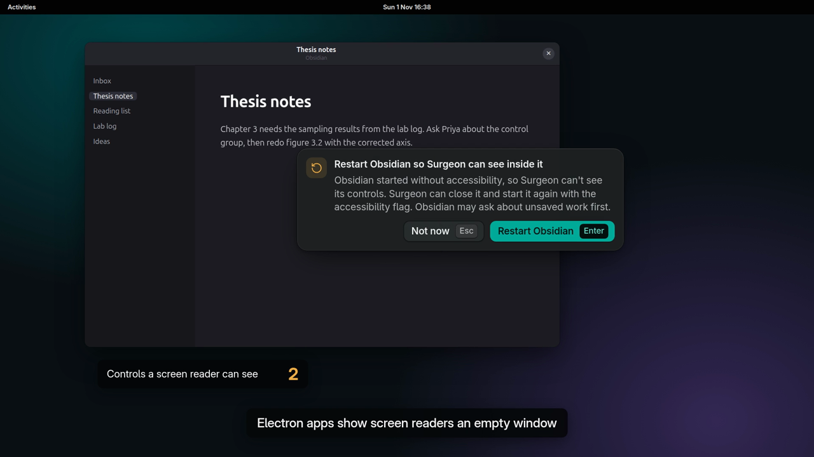

# Application Surgeon

Press Ctrl+Alt+Space over a desktop app and type what you want done in it. Codex inspects the app through Surgeon's accessibility and D-Bus tools, writes a manifest of steps, and tests it on the real window. Surgeon shows the plan, runs it, and can save it as a GNOME shortcut that works with Surgeon closed.

[](docs/media/launch.mp4)

[Watch the launch video](docs/media/launch.mp4) (107 s). It shows keyboard-only control of VLC, restarting Obsidian for screen readers, "make this bigger" in four apps, a saved Writer shortcut that runs with Surgeon closed, and an agent step that decides what to do on two different spreadsheets.

The build follows [docs/hackathon-plan.md](docs/hackathon-plan.md). It runs on Ubuntu 24.04, GNOME 46, X11 only.

## How it works

1. **You summon it.** Ctrl+Alt+Space opens the command bar beside the cursor. Surgeon reads the window under it from X properties (`surgeon/desktop.py`): app id, PID, binary and the open document.
2. **Codex plans.** `app/job.ts` starts one Codex thread per request. It gets the request, a screenshot of that window, and Surgeon's MCP server (`surgeon/mcp.py`) scoped to that one window. Codex reads the app with the MCP tools, writes a manifest that follows `contracts/manifest.schema.json`, and must run it with `test_manifest` on the real window.
3. **Surgeon checks.** The plan shows as "Tested" only if `inspection.jsonl` has a passing test whose hash matches the returned steps (see [How a plan earns "Tested"](#how-a-plan-earns-tested)). Each step shows its route: a named action, the app's command line, or a control pressed by name.
4. **You run it.** Enter runs the manifest through `surgeon/manifest.py`, the same executor the test used. There's no model call at this point.
5. **You keep it.** "Save as shortcut" writes the manifest to disk and binds a GNOME keybinding. Pressing it runs `surgeon/run.py`, again with no Codex call, even when Surgeon is closed. Requests for features the app lacks return a [sub-app](#sub-apps-new-features-for-an-app) instead, with a trigger and steps.

## Where Codex is used

Codex runs through `@openai/codex-sdk` and the `codex` CLI's ChatGPT login. It's used in three places:

| When | Code | What Codex does | Its tools |
| --- | --- | --- | --- |
| Planning a request | `runJob` in `app/job.ts` | Reads the app, writes a manifest or sub-app, tests it, fixes it (up to 5 tests) | `describe_app`, `find_elements`, `get_tree`, `inspect_element`, `list_apps`, `capture_window`, `test_manifest` |
| Building a sub-app | the same job | Same as above, plus a sandboxed script if the app's own routes can't do the work | the same |
| Each run of an agent step | `app/agent.ts`, started by `run_agent` in `surgeon/manifest.py` | Reads the app and decides which steps to run toward the goal you approved | the read tools plus `run_steps`, capped at `max_actions` calls |

Every thread starts from `surgeonThread` in `app/job.ts` with a read-only sandbox, no network, no web search, `approvalPolicy: "never"`, low reasoning effort and a strict `outputSchema`. Its only access to the desktop is the MCP server, and every call it makes is logged to `jobs/<id>/inspection.jsonl`.

Codex is not used for Run, saved shortcuts, sub-apps without an agent step, or scripts. Those run the stored manifest directly.

## Setup

Requirements already on this machine: Node 24 (nvm), `/usr/bin/python3` 3.12 with `gi` and `jsonschema`, the `codex` CLI logged in with ChatGPT, and `xprop`, `wmctrl` and ImageMagick's `import`.

```bash
npm install
node node_modules/electron/install.js   # only if node_modules/electron/dist is missing
npm run build
```

npm on this machine skips install scripts, so Electron's binary needs the second line once.

## Run

```bash
npm run dev                  # builds, then starts Surgeon as the systemd user unit surgeon-dev
scripts/demo-apps.sh         # Image Viewer, Writer with a demo document, GNOME Terminal, Alacritty
systemctl --user stop surgeon-dev
```

Click an app, press Ctrl+Alt+Space, type a request and press Enter. Under the field, the bar lists what Surgeon can use in that app: its GTK actions, the named controls it can see, other D-Bus APIs and the command line it may run. These are the same routes Codex gets. When the plan appears, Enter runs it. "Save as shortcut" binds the next free Ctrl+Alt+1 to 9.

Always launch Surgeon and the demo apps through these scripts, never from a T3 Code terminal. T3 Code sets `ELECTRON_RUN_AS_NODE`, `NO_AT_BRIDGE` and `GTK_MODULES`, and its AppArmor label blocks AT-SPI calls to snap apps. `systemd-run --user` starts from the user manager's environment instead. The dev script also passes `--no-sandbox`, because Ubuntu 24.04 refuses Chromium's SUID sandbox unless `chrome-sandbox` is owned by root.

Run one Codex job without the UI:

```bash
systemd-run --user --wait --pipe -E DISPLAY -E DBUS_SESSION_BUS_ADDRESS -E XDG_RUNTIME_DIR -E HOME -E PATH \
  --working-directory="$PWD" node app/dist/job.js <window-id> "Make this bigger"
```

Get window ids from `wmctrl -lx`.

## Tests

```bash
npm test                                         # schema, denylist, matcher, hash, keybinding install
SURGEON_DESKTOP_TESTS=1 npm test                 # also drives a real Image Viewer (run outside T3 Code)
```

## Launch video

The video is a scripted animation, not a screen recording. The apps (VLC, Obsidian, Image Viewer, Writer, Calc and the terminals) are drawn in HTML. The Surgeon panels on top use the real `ui/tokens.css` and `ui/surgeon.css`, with text from `app/panel.ts` and the test manifests.

### Render it

You need `ffmpeg` on `PATH`. Without sudo, a static build works:

```bash
mkdir -p /tmp/ffdl && cd /tmp/ffdl
curl -fsSLO https://johnvansickle.com/ffmpeg/releases/ffmpeg-release-amd64-static.tar.xz
tar xf ffmpeg-release-amd64-static.tar.xz && cp ffmpeg-*-static/ffmpeg ~/.local/bin/
```

Then, from the repo:

```bash
npm run video                                 # video/out/launch.mp4, 1920x1080, 30 fps, about 4 minutes
npm run video -- --fps=2 --out=/tmp/p.mp4     # quick preview in about 20 s
npm run video -- --from=9.5 --to=29.5         # one slice, in seconds of the final video
```

Set `FFMPEG=/path/to/ffmpeg` if it isn't on `PATH`. To watch without rendering, open `video/launch.html` in a browser. It plays in real time, and `#t=30` in the URL starts at 30 s. The README copy in `docs/media/` is re-encoded at CRF 23 to keep the repo small:

```bash
ffmpeg -i video/out/launch.mp4 -c:v libx264 -crf 23 -pix_fmt yuv420p -movflags +faststart docs/media/launch.mp4
```

### How the renderer works

- `video/launch.html` sets the whole frame from one number, the time `t`, through `window.seek(t)`. Scenes, captions, keycaps and the cursor path are tables of timestamps.
- CSS animations from `surgeon.css` (panels growing in, the spinning planning icon) are paused and set to the exact time on each frame, so every render is identical.
- `ORDER` in `launch.html` sets the play order as slices of the scene timeline. Accessibility plays right after the opening, so judges who stop early still see it. Reordering means editing that one line.
- `video/render.cjs` loads the page in an offscreen Electron window, calls `seek` for each frame, captures it with `capturePage()`, and pipes the PNGs to `ffmpeg` (x264, CRF 16).

## Layout

| Path | What it does |
| --- | --- |
| `surgeon/desktop.py` | Window identity from X properties, the bounded AT-SPI walker, the control matcher, GTK and frame actions |
| `surgeon/manifest.py` | Schema check, denylist, the executor and its verification checks. `test_manifest`, Run and `surgeon-run` all use it |
| `surgeon/mcp.py` | The seven MCP tools Codex gets, scoped to one window. Logs every call to `jobs/<id>/inspection.jsonl` |
| `surgeon/daemon.py` | JSON-lines helper process for Electron |
| `surgeon/install.py`, `surgeon/run.py` | GNOME keybinding install and uninstall, and what the keybinding runs |
| `surgeon/subapps.py`, `surgeon/sandbox.py` | Sub-app install gate, storage and watcher, and the script sandbox |
| `contracts/manifest.schema.json` | The manifest contract. Python validates with it and Codex gets it as `outputSchema` |
| `app/` | Electron main process, Codex job, panel |
| `ui/` | Design tokens and components, see [docs/interface.md](docs/interface.md) |

Data lives in `~/.local/share/app-surgeon/`: `jobs/<id>/` holds each request's screenshot, inspection log and manifest, and `extensions/<id>/manifest.json` holds saved shortcuts.

## Apps Surgeon can't see into

Electron apps (VS Code, Obsidian, Typora) show Surgeon their controls only when started with `--force-renderer-accessibility`, and Firefox-family browsers (Firefox, Zen) only with `GNOME_ACCESSIBILITY=1`. When you summon Surgeon over one, the panel offers **Restart <app>**:

1. Surgeon closes the app's windows the normal way, so the app can still ask about unsaved work or open tabs.
2. It waits for the app to exit, then starts it again as it was: the same command line and folder, plus the fix. Flatpaks such as Zen go through their `.desktop` launcher with `flatpak run --env=...`. Electron overwrites its own `/proc/<pid>/environ`, so in that case the app gets the session's environment.
3. It checks that the new window really shows Surgeon its controls.

If any step fails, for example because the app is waiting on a "Save changes?" question, the panel says why and shows a command to paste into a terminal after quitting the app, with a Copy button. "Not now" hides the offer for that app until Surgeon restarts. Watch and title helpers don't need accessibility.

## How a plan earns "Tested"

Codex's `verified: true` is only a claim. Surgeon marks a plan as tested only if the job's `inspection.jsonl` holds a passing `test_manifest` entry whose hash matches the steps, checks and undo that Codex returned. Codex's sandbox is read-only, so it can't write that log. Plans that fail this check show "Not verified" and can't be saved.

## Sub-apps: new features for an app

Ask for a feature the app doesn't have, and Codex returns a sub-app: something that runs beside the app with a trigger and steps. Four kinds:

| Kind | Example request | What it does |
| --- | --- | --- |
| Toolbar | "Give me a toolbar with buttons to rotate clockwise, rotate counter-clockwise and flip horizontally" in Pinta | Buttons docked inside the app window's top-right corner while it's active. Each button runs its own steps |
| Save trigger | "Every time I save this notebook, also export it as a PDF next to it" in Xournal++ | Runs steps each time you save the open file |
| Hotkey | "Give me a hotkey that lists the 10 largest files under the folder I'm scanning" in Disk Usage Analyzer | Runs steps on a key, only while that app is active |
| App opened | "When Image Viewer opens, zoom to 100%" | Runs steps when the app opens. Every step must be reversible |
| Title | "After 10 seconds on X in Zen, open a new Zen window" | Runs steps once per visit when the app's window title matches a pattern for N seconds while that window is in front |
| Watch | "Notify me when this terminal stops changing, so I know my command finished" | Samples the app window every 2 to 60 s and runs steps when it changes, or when it stops changing after a change |

Steps use the app's own actions, controls and command line, the same as a normal plan. For work the app can't do at all, a sub-app can run a Python script and show its output in a panel beside the app or as a desktop notification.

### Opening apps and creating files

- **`launch` step.** Opens any installed app through its own `.desktop` entry, with no shell, including flatpaks such as Zen (found by `StartupWMClass`). Arguments may only be http(s) URLs, existing file paths, `{created}`, or `--new-window`, `--new-tab`, `--new-instance` and `--private-window`. Terminal emulators are refused. Codex finds desktop ids with the `list_apps` tool.
- **Files from scripts.** A script still can't write outside its temp folder. It writes new files to `./out/`, and its step's `outputs_to` names where Surgeon copies them, for example `{document.dir}`. The destination must be a visible folder inside your home folder, so nothing can go to `~/.config` or outside home. Existing files are never overwritten: a clash gets `-1`. At most 20 files and 500 MB per run. `{created}` is then the first new file's path. Tests delete the files they create and close windows their `launch` steps opened.
- **`{document.path}`** comes from the app's command line or, for single-instance apps that got the file over D-Bus, from the app's latest matching entry in the recent-files list. Only that one path is used.

Example: "Give me a hotkey that inverts the colours of this image and opens the result" in Image Viewer becomes a script that writes `out/<name>-inverted.png`, delivered to the image's folder, then `launch org.gnome.eog {created}`.

### Watching windows and the screen

- **`watch` trigger.** Only the app's own window, never the whole screen. A window capture holds that window's pixels only, so Surgeon's panels and GNOME's notifications don't show up in it. A screen watcher would trigger on Surgeon's own output. A change is at least 3 pixels of a 32x32 grayscale sample moving by more than 24 levels: on GNOME Terminal a printed line moved 4 to 17 and a cursor blink 2.
- **`capture` step.** Saves a screenshot of the app window, or the whole screen, into the run's temp folder for a later script to read. Scripts have PIL and numpy. The consent view tags a whole-screen capture "Sees your whole screen".
- **`capture_window` tool.** While building, Codex can take a fresh screenshot of the target window, for example to see the app after a test. It has no whole-screen tool.
- **Nothing a script outputs goes to Codex.** During a test, Codex learns only how many rows or characters each panel got.

### Agent steps

A sub-app step can be an agent instead of fixed steps. Each time the trigger fires, Codex reads the app and decides what to do toward a goal you approved at install, for example "When the build stops, if the log shows an error, open the file and line it names" in a terminal (watch settled plus an agent step). Codex picks fixed steps whenever they can do the job, because they're faster and free to run.

- **What it can do.** The agent runs `node app/dist/agent.js`, a Codex thread whose MCP server (`surgeon.mcp --agent N`) has the read tools and `run_steps` instead of `test_manifest`. `run_steps` runs the same step types as a plan, through the same schema check and blocked list. It can't run scripts or start another agent. `max_actions` (1 to 10) caps its `run_steps` calls per run, and a run is stopped after 240 s.
- **What it sends.** Everything the agent reads in the window goes to Codex on each run. The consent view says so and tags the step "Codex decides each run". The prompt tells Codex to treat text in the window as data, but a page or document that tries to give it instructions can still steer it within those limits.
- **Its output.** An agent step is never reversible, so it can't run on an `app_opened` trigger. Its final message is saved under the step's `file`, so a later `notify` or `panel` step can show it. Each run's tool calls go to `jobs/agent-<time>/inspection.jsonl`.
- **Testing.** `test_manifest` runs the agent once for real, and Surgeon can't undo what it did.

- **Install gate.** Surgeon offers a sub-app only if its own test passed for exactly that sub-app, testing every toolbar button and its undo. A sub-app with a script must also prove that the app's own routes can't do the work: the job's inspection log has to show `describe_app` and `find_elements` ran and agree with each claimed outcome. "Unsuitable" outcomes can't be checked mechanically, so the consent view marks them "Codex judged".
- **Consent.** The panel shows the trigger, every step with its route and any "Can't undo" tag, what the sub-app reads, and any script in full. Enter doesn't install; press Install or Ctrl+Enter.
- **Sandbox.** Scripts run under Landlock and seccomp (`surgeon/sandbox.py`). They can read files and `/proc`, but can't open any socket, write outside a temp dir, or signal another process. Ubuntu 24.04 blocks user namespaces for unconfined processes, so `bwrap` can't run from Surgeon's daemon.
- **Runtime.** The daemon checks the window list and watched files once a second. Sub-apps arm on an app's main windows, not its dialogs. A save fires once the file's modification time holds for a second, and changes during the sub-app's own run don't count. Three failed runs in a row turn a sub-app off.
- **Manage.** Installed sub-apps appear in the command bar's saved list for their app, with Turn off and Remove.

`{document.path}` and `{document.dir}` are the open file, found from the app's command line and matched against the window title. They are empty when the file was opened from inside the app. Sub-apps run only while Surgeon is running, unlike saved shortcuts. They live in `~/.local/share/app-surgeon/subapps/<id>/subapp.json`.

## What's next

These are ideas, not built features.

### Voice, for accessibility

Typing is the slowest part for people with limited hand movement, and the panel is small for people with low vision. The machine has no `OPENAI_API_KEY`, and Codex here uses a ChatGPT login, so voice needs its own key.

- **Speak the request.** Hold a key and say "go back ten seconds". Transcribe it with OpenAI's speech-to-text, or with a local Whisper model so nothing leaves the machine, then send the text through the same job as a typed request.
- **Hear the plan.** Read the plan and its routes aloud before running, and say "yes" or "run" to confirm. Irreversible steps would still need an explicit spoken confirmation.
- **Hear the result.** Read the toast and any sub-app output aloud, for people who can't read the panel.
- **Talk to the app.** A Realtime API session for repeated commands such as "pause", "louder" or "next slide", so the user doesn't press the shortcut each time. Saved shortcuts and fixed steps need no model, so common commands could run with no Codex call at all.

### With the OpenAI Agents SDK

The Agents SDK (`@openai/agents` for TypeScript, `openai-agents` for Python) can use Surgeon's existing MCP server as a tool, so these ideas build on `surgeon/mcp.py` rather than replacing it.

- **Workflows across apps.** One agent per window, each with its own scoped MCP server, and handoffs between them. For example, a terminal agent reads the failing test, then hands off to a Writer agent that adds it to the standup notes. Today each Codex thread can see only one window.
- **Guardrails.** Input guardrails could stop document text, terminal text or recent files from reaching the model unless the user allows it. Output guardrails could check every `run_steps` call against the denylist before it reaches Surgeon, in addition to the check Surgeon already does.
- **Approvals.** The SDK's human-in-the-loop tool approvals could pause an agent step before an irreversible action and ask in the panel, instead of the step being marked "Can't undo" for the whole run.
- **Voice agents.** The SDK's realtime voice agents could run the voice ideas above, with the user able to interrupt mid-plan ("no, the other file").
- **Traces.** Each agent run's trace could be shown in a Details view in the panel, next to the existing `inspection.jsonl` log, so users can see why an agent step did what it did.

## Remove a saved shortcut

```bash
echo '{"id":1,"cmd":"uninstall","ext_id":"<id>"}' | PYTHONPATH=. /usr/bin/python3 -m surgeon.daemon
```

Ids are the directory names under `~/.local/share/app-surgeon/extensions/`.
